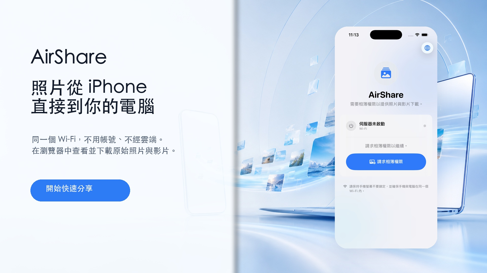
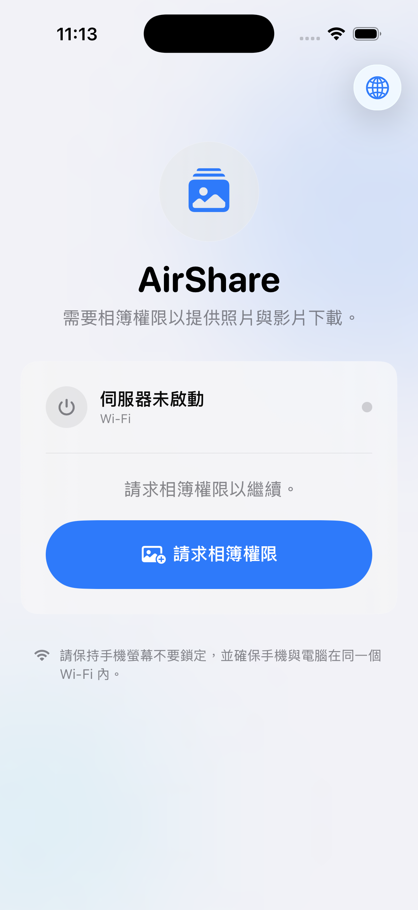

# AirShare

[繁體中文](README.md) · [English](README.en.md) · [日本語](README.ja.md) · [介紹網站](https://yenyuy.github.io/AirShare/)

AirShare 是一款讓手機與電腦在同一個 Wi-Fi 網路內直接傳送照片與影片的原生應用程式。無需帳號、傳輸線、雲端上傳或電腦端軟體；在手機上啟動分享後，用電腦瀏覽器開啟 App 顯示的網址即可瀏覽及下載原始檔案。



## 特色

- 支援 iOS 與 Android
- 照片與影片只在區域網路內傳輸
- 電腦端不需安裝任何程式，瀏覽器即可使用
- 可下載原始照片與影片
- 提供 QR Code 與區域網路網址，快速連線
- 支援繁體中文、英文與日文
- 不需註冊帳號，也不經過第三方雲端服務

## 使用方式

1. 允許 AirShare 存取照片與影片。
2. 將手機與電腦連接到同一個 Wi-Fi 網路。
3. 在 AirShare 中啟動分享。
4. 用電腦掃描 QR Code，或在瀏覽器輸入畫面上的網址。
5. 選擇並下載需要的照片或影片。

> 傳輸期間請保持 AirShare 開啟，並讓手機維持喚醒狀態。請只在信任的區域網路中啟動分享。

## 畫面預覽

| 準備分享 | 分享中 |
| --- | --- |
|  |  |

## 專案結構

- `AirShare/`：iOS App（SwiftUI）
- `AirShare-Android/`：Android App（Kotlin、Jetpack Compose）
- `AppStore/`：商店文案、原始截圖與行銷素材
- `index.html`：GitHub Pages 介紹網站

## 開發需求

### iOS

- Xcode
- iOS 16.0 以上

以 Xcode 開啟 `AirShare.xcodeproj`，選擇簽署團隊與目標裝置後執行。

### Android

- Android Studio 或 JDK 17
- Android SDK 36
- Android 10（API 29）以上

```bash
cd AirShare-Android
./gradlew assembleDebug
```

## 隱私

AirShare 的核心傳輸流程在使用者自己的區域網路內完成，不需將媒體上傳到 AirShare 或第三方雲端。平台相關隱私與上架說明請參閱 [`AirShare-Android/docs/`](AirShare-Android/docs/)。
